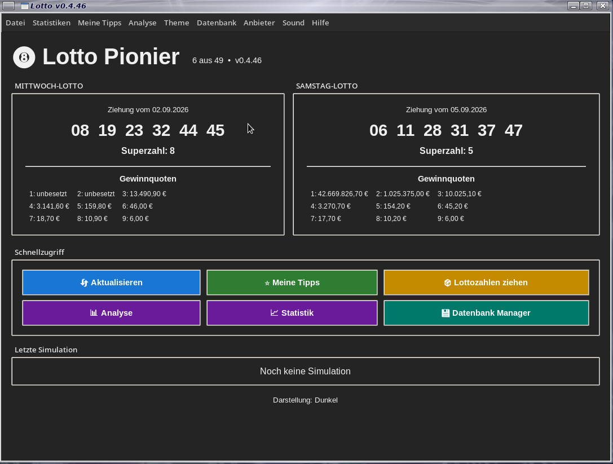

# Lotto Pionier v0.4.47 🍀

Lotto Pionier ist ein Lotto-Programm mit Statistik, Tippfunktionen, Datenbank-Unterstützung und eigener Gewinn-Glocke.



[Github Seite](https://github.com/Angonikro/Lotto-Pionier/)

## Funktionen

- 🎱 Lottozahlen anzeigen und aktualisieren
- 📊 Statistik und Analyse
- ⭐ Eigene Tipps
- 💾 Datenbank-Unterstützung
- 🔔 Eigene Gewinn-Glocke
- 🌙 Helles und dunkles Theme

## Installation

### Windows

1. ZIP-Datei entpacken.
2. Python 3 installieren.
3. Im Lotto-Ordner ein Terminal öffnen.
4. Abhängigkeiten installieren:

```bash
pip install -r requirements.txt
```

5. Starten:

```bash
python Lotto.py
```

### Linux

1. ZIP-Datei entpacken.
2. Terminal im Lotto-Ordner öffnen.
3. Falls nötig:

```bash
sudo apt install python3-pip
```

4. Abhängigkeiten installieren:

```bash
python3 -m pip install -r requirements.txt
```

5. Starten:

```bash
python3 Lotto.py
```

## Desktop Launcher (Linux)

Launcher-Rechte setzen:

```bash
chmod +x install_desktop_launcher.sh
```

Launcher installieren:

```bash
./install_desktop_launcher.sh
```

Danach kann Lotto Pionier über das Anwendungsmenü gestartet werden.

## Download

Die aktuelle Version findest du unter den GitHub Releases.

## Version

Lotto Pionier v0.4.47


## v0.4.47
- Aktuelle Samstag-Ziehung wird auch dann gespeichert/angezeigt, wenn die Gewinnquoten noch nicht veröffentlicht sind.
- Windows-Soundtreiber über `winsound` ergänzt.
- Sound-Treiber „Auto“ ergänzt.


## Speicherorte unter Linux

- Einstellungen: `~/.config/lotto-pionier/settings.ini`
- Datenbank und erzeugte Sounddatei: `~/.local/share/lotto-pionier/`

Vorhandene Einstellungen aus älteren Speicherorten werden beim ersten Start übernommen, sofern noch keine neue Konfigurationsdatei existiert. `XDG_CONFIG_HOME` und `XDG_DATA_HOME` werden berücksichtigt.


## Einstellungen und Daten unter Linux

- Einstellungen (einschließlich Theme): `~/.config/lotto-pionier/settings.ini`
- Datenbank und erzeugte Sounddatei: `~/.local/share/lotto-pionier/`
- `XDG_CONFIG_HOME` und `XDG_DATA_HOME` werden berücksichtigt.
- Eine vorhandene alte `data/settings.ini` wird beim ersten Start übernommen, wenn noch keine Benutzerkonfiguration existiert.
- Theme-Wechsel werden sofort gespeichert; beim Speichern bleiben auch weitere Konfigurationsabschnitte wie die Anbieterauswahl erhalten.


### Startkorrektur 0.4.47
Beim Start wird das persönliche Datenverzeichnis automatisch angelegt, bevor die SQLite-Datenbank geöffnet wird.

73 de DO2QG Andreas
